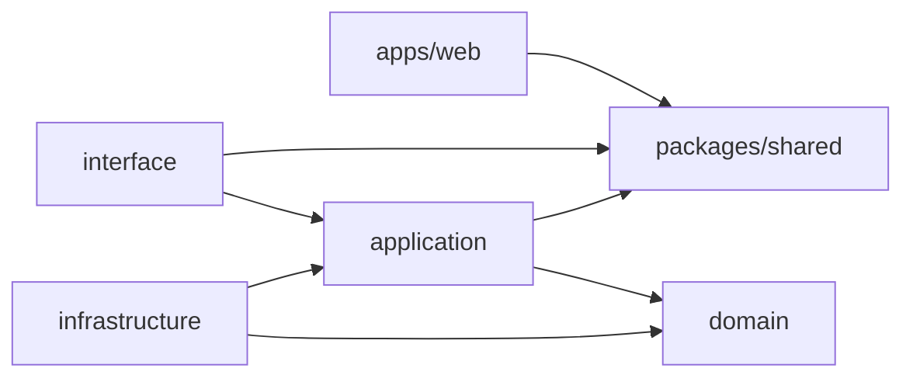

# ARCHITECTURE.md

> **Mục đích của tệp này**: nguồn thông tin duy nhất về cách kho mã được tổ chức và vì
> sao. Bất kỳ ai — người hay trợ lý AI — bắt đầu làm việc với dự án đều phải đọc tệp này
> **trước khi** khám phá mã nguồn và trước khi viết mã mới.
>
> **Tệp này mô tả HIỆN TRẠNG và các KHUÔN MẪU BẮT BUỘC, không phải nhật ký thay đổi hay kế
> hoạch.** Kế hoạch thuộc `ROADMAP.md`. Tiến độ thuộc `PROJECT_STATE.md`. Luật chơi thuộc
> `game-rules.md`. Mục nào mới ở dạng thiết kế đều ghi *"chưa cài đặt"* ngay đầu mục. Khi
> cài đặt hoặc thay đổi một khuôn mẫu, **bắt buộc** cập nhật mục tương ứng trong cùng công
> việc đó — xem mục 16.

---

## 1. Tóm tắt dự án

**Làng Trăng Mờ (MoonVillage)** — hệ thống hỗ trợ trò chơi suy luận nhóm dạng Ma Sói chạy
trên trình duyệt, **tự động hóa hoàn toàn vai trò quản trò**. Đồ án học phần *Phân tích
thiết kế hướng đối tượng*, Nhóm 13, Trường Đại học Thủ Dầu Một, giảng viên hướng dẫn ThS.
Trần Hữu Duật.

**Bài toán**: tổ chức Ma Sói ngoài đời vướng năm trở ngại — phải tụ đủ người, mất một suất
chơi cho quản trò, quản trò xử lý sai khi năng lực chồng lấn, không có bản ghi sau ván,
người mới không thuộc luật. Hệ thống giải quyết cả năm bằng cách thay quản trò bằng máy.

**Điểm khác biệt**: dành cho **nhóm bạn quen chơi phòng riêng**, chủ phòng **bật tắt sáu
quy tắc** để khớp biến thể luật của nhóm, và **mở toàn bộ nhật ký hành động đêm** sau ván.

**Phạm vi đã chốt**: web, trò chuyện văn bản, phòng 6–12 người, sáu vai cố định, chơi theo
lượt có đếm giờ, tài khoản – lịch sử – xếp hạng, kiểm duyệt, luật tùy biến sáu quy tắc,
chế độ người chơi ảo phục vụ kiểm thử. Ngoài phạm vi xem mục 14.

**Giai đoạn hiện tại**: Giai đoạn 0 — đã có công cụ và điểm cuối `/api/health`, **chưa có mã
nghiệp vụ**. Mọi khuôn mẫu từ mục 5 trở đi đều *chưa cài đặt*.

**Tài liệu gốc**: *Tài liệu dự án toàn diện — Làng Trăng Mờ, bản 1.0* (tệp `.docx` giữ ngoài
kho mã). Bảy sơ đồ PlantUML của tài liệu đã chép vào `docs/diagrams/`.

---

## 2. Năm nguyên tắc bất di dịch

Mọi quyết định kỹ thuật phải giữ được năm điều dưới đây. Một yêu cầu buộc phá một trong
năm điều thì **dừng lại và hỏi** trước khi làm.

### 2.1. Máy chủ là trọng tài duy nhất — PC04

Toàn bộ luật chơi chạy ở máy chủ. Trình duyệt **không chứa một dòng luật nào** và chỉ nhận
**góc nhìn** đã lọc theo đúng người nhận — xem mục 8. Nếu logic nằm ở trình duyệt, người
chơi mở công cụ phát triển là đọc được vai người khác.

**Kiểm tra nhanh**: nếu mã phía `apps/web` có câu `if` so sánh tên vai của *người khác*,
hoặc tính người chết, hoặc tính phe thắng — đó là vi phạm.

### 2.2. Ghi ý định trước, giải quyết tập trung sau — PC03

Trong pha đêm, hành động của mỗi vai chỉ tạo một đối tượng `HanhDongDem` lưu **ý định**.
Không vai nào tự sửa trạng thái người chơi. `BoGiaiQuyetDem` gom toàn bộ ý định, áp dụng
theo `doUuTien`, xử lý xung đột, rồi mới đánh dấu người chết — xem mục 6.

Ba lý do: Phù thủy hành động sau Sói nên cần biết ai vừa bị cắn; Bảo vệ đỡ đúng người thì
cú cắn vô hiệu; Phù thủy cứu thì cú cắn cũng vô hiệu. Cho vai tự sửa trạng thái thì kết
quả phụ thuộc thứ tự bấm nút.

### 2.3. Bộ luật bất biến trong ván

`BoLuatChoi` được **sao chép** vào `VanDau` lúc bắt đầu ván và đóng băng tới hết ván. Chủ
phòng sửa luật cho ván sau không làm đổi cách diễn giải nhật ký ván đang chạy (TC20).

### 2.4. Lõi miền không phụ thuộc gì

`apps/server/src/domain/` **không được nhập** bất cứ thứ gì ngoài chính nó: không
`application`, không `infrastructure`, không Express, Socket.IO, Prisma. Lõi miền cũng
**không tự đọc giờ hệ thống và không gọi `Math.random()`** — thời gian và số ngẫu nhiên đi
vào qua hai cổng `DongHo` và `NguonNgauNhien` (mục 9). Nhờ vậy mọi lớp vai và bộ giải quyết
kiểm thử được độc lập, cho kết quả lặp lại được.

Quy tắc này được **lint chặn tự động**, không dựa vào kỷ luật — hạng mục ROADMAP 0.7.

### 2.5. Người chơi ảo đi chung luồng với người thật

Người chơi ảo là một **bộ chuyển đổi** gửi lệnh vào đúng cửa mà cổng Socket.IO dùng. Không
có nhánh `if (laNguoiChoiAo)` nào trong lõi miền hay tầng ứng dụng. Phải viết nhánh riêng
cho người ảo nghĩa là luật đang rò ra khỏi tầng nghiệp vụ.

---

## 3. Bộ công nghệ

Trạng thái: **Đã chấp nhận** — [ADR-0001](adr/0001-chon-bo-cong-nghe.md), 19/10/2026. Không đưa công nghệ khác vào mà không cập nhật mục này và viết ADR mới.

| Tầng | Công nghệ | Giấy phép | Ghi chú |
|---|---|---|---|
| Ngôn ngữ | TypeScript `strict` | Apache-2.0 | Dùng cho cả máy chủ, giao diện, gói dùng chung |
| Môi trường chạy | Node.js 24 LTS | MIT | |
| Máy chủ HTTP | Express 5 | MIT | Chỉ ở `interface/api` |
| Đồng bộ tức thời | Socket.IO 4 | MIT | Tự lùi về long-polling — chính là phương án dự phòng mục 13.3 tài liệu gốc |
| Kiểm tra dữ liệu vào | Zod | MIT | Mọi lệnh từ trình duyệt đi qua lược đồ Zod trước khi chạm tầng ứng dụng |
| Cơ sở dữ liệu | PostgreSQL 17 | PostgreSQL License | Cột `JSONB` cho trạng thái kỹ năng — PC09 |
| Truy xuất dữ liệu | Prisma | Apache-2.0 | Chỉ ở `infrastructure/repository` |
| Xác thực | bcryptjs + JWT trong cookie `httpOnly` (`jose`) | MIT | |
| Giao diện | React 19 + Vite, React Router, Zustand | MIT | Ứng dụng một trang, không cần kết xuất phía máy chủ |
| Kiểu dáng | Tailwind CSS 4 | MIT | Token màu, chữ, khoảng cách xuất từ thiết kế Claude Design — mục 4.2 |
| Kiểm thử | Vitest | MIT | |
| Đóng gói | Docker Compose | Apache-2.0 | MVP chỉ cần PostgreSQL chạy trong Compose |
| Tổ chức kho | npm workspaces | — | Không cần cài thêm trình quản lý gói |

---

## 4. Cấu trúc thư mục

### 4.1. Hiện trạng

Công cụ đã dựng (Giai đoạn 0): kho nhiều gói npm workspaces, TypeScript `strict`, ESLint có
rào chắn phụ thuộc, Prettier, Vitest, Vite. **Chưa có mã nghiệp vụ** — `domain/`,
`application/` và phần lớn `apps/web/src/` vẫn là thư mục rỗng chứa `.gitkeep`. Chưa khởi
tạo Git.

```
WereWolf_Game/
├── .github/workflows/ci.yml     # lint + typecheck + test + build web trên mỗi pull request
├── apps/
│   ├── server/
│   │   ├── src/main.ts          # khởi động Express ở cổng PORT (mặc định 3000)
│   │   ├── src/interface/api/app.ts   # createApp() — GET /api/health
│   │   ├── src/domain/…         # khung rỗng
│   │   ├── tests/health.test.ts
│   │   └── vitest.config.ts
│   └── web/
│       ├── vite.config.ts       # proxy /api và /socket.io sang :3000
│       ├── index.html
│       └── src/App.tsx          # trang tạm gọi /api/health — chưa phải giao diện thật
├── packages/shared/src/index.ts # TEN_UNG_DUNG, PhanHoiSucKhoe
├── infra/
│   ├── docker-compose.yml       # PostgreSQL 17
│   └── .env.example
├── docs/                        # ARCHITECTURE, PROJECT_STATE, ROADMAP, game-rules, adr/, diagrams/
├── eslint.config.js             # RÀO CHẮN: domain/ không nhập ra ngoài; web không nhập server
├── tsconfig.base.json
├── package.json                 # lệnh gốc: dev, test, lint, typecheck, format, db:up, db:down
├── AGENTS.md · CLAUDE.md · README.md
```

**Rào chắn trong `eslint.config.js`** (hạng mục 0.7, đã thử bằng tệp nhập sai): trong
`apps/server/src/domain/**` cấm mọi lần nhập không phải đường dẫn tương đối (kể cả `node:*` và
`@moonvillage/shared`), cấm đường dẫn chứa `application`, `infrastructure`, `interface`, cấm
`Date`, `setTimeout`, `setInterval`, `process`, `Math.random`. Trong `apps/web/**` cấm nhập
`@moonvillage/server` hoặc đường dẫn tới `apps/server`.

**`packages/shared` không biên dịch riêng**: `main` trỏ thẳng vào `src/index.ts`; `tsx` và Vite
đọc TypeScript trực tiếp.

### 4.2. Cấu trúc dự kiến khi có mã nguồn

Ghi trước để ba thành viên đặt tệp cùng một kiểu. Phần `domain/` và `application/` giữ
đúng cấu trúc mục 15.2 tài liệu gốc.

```
WereWolf_Game/
├── apps/
│   ├── server/                          # MÁY CHỦ ỨNG DỤNG — tầng nghiệp vụ
│   │   ├── src/
│   │   │   ├── domain/                  # LÕI MIỀN — không nhập gì ngoài chính nó
│   │   │   │   ├── chung/               # Phe, LoaiHanhDong, MaQuyTac, TrangThaiVan, LoiNghiepVu,
│   │   │   │   │                        #   cổng DongHo và NguonNgauNhien
│   │   │   │   ├── vaitro/              # VaiTro (trừu tượng) + DanLang BaoVe Soi TienTri PhuThuy ThoSan
│   │   │   │   ├── kenh/                # KenhChat (trừu tượng) + KenhChung KenhSoi KenhNguoiChet
│   │   │   │   ├── van/                 # VanDau LuotChoi NguoiChoi HanhDongDem KetQuaDem NhatKyVan
│   │   │   │   │   └── trangthai/       # mẫu State — một lớp cho mỗi trạng thái của VanDau
│   │   │   │   ├── luat/                # BoLuatChoi CauHinhVai
│   │   │   │   └── baucu/               # PhienBauCu PhieuBau
│   │   │   ├── application/             # CÁC LỚP ĐIỀU KHIỂN — vẫn không IO trực tiếp
│   │   │   │   ├── BoDieuPhoiVan.ts     # vòng đời ván, chuyển pha, gọi bộ xử lý con đúng thứ tự
│   │   │   │   ├── BoChiaVai.ts         # Factory — sinh VaiTro theo cấu hình, xáo trộn, gán
│   │   │   │   ├── BoGiaiQuyetDem.ts    # Chain of Responsibility — áp hiệu ứng, dây chuyền Thợ săn
│   │   │   │   ├── BoKiemTraThangThua.ts
│   │   │   │   ├── BoQuanLyKenh.ts      # kênh nào mở, ai xem được gì, lúc nào
│   │   │   │   ├── BoHenGio.ts          # tác nhân AC04 — trên cổng DongHo
│   │   │   │   ├── BoPhatSuKien.ts      # Observer — phát sự kiện miền kèm đối tượng nhận
│   │   │   │   ├── CongLuaChon.ts       # cổng chờ lựa chọn của người chơi hoặc hết giờ
│   │   │   │   └── taoGocNhin.ts        # chiếu trạng thái ván thành góc nhìn của MỘT người — mục 8
│   │   │   ├── infrastructure/          # BỘ CHUYỂN ĐỔI ra thế giới bên ngoài
│   │   │   │   ├── repository/          # Prisma — lưu tài khoản, phòng, ván, nhật ký
│   │   │   │   ├── realtime/            # Socket.IO — ánh xạ đối tượng nhận thành phòng socket
│   │   │   │   ├── auth/                # băm mật khẩu, ký và kiểm JWT
│   │   │   │   └── bot/                 # NguoiChoiAo — gửi lệnh qua đúng cửa của người thật
│   │   │   ├── interface/
│   │   │   │   ├── api/                 # điểm cuối REST: tài khoản, phòng, lịch sử
│   │   │   │   └── ws/                  # bộ nhận lệnh socket: hành động, bỏ phiếu, gửi tin
│   │   │   └── main.ts                  # lắp ráp phụ thuộc, khởi động
│   │   ├── prisma/                      # schema.prisma, migrations/, seed.ts
│   │   └── tests/
│   │       ├── domain/                  # đơn vị — TC07, TC08, TC16, TC17, kênh, bộ luật
│   │       ├── application/             # tích hợp — TC01–TC06, TC09–TC15, TC18–TC20
│   │       └── system/                  # ST01, ST02, ST04 chạy bằng người chơi ảo, không giao diện
│   └── web/                             # GIAO DIỆN — React + Vite
│       ├── src/
│       │   ├── screens/                 # một thư mục cho mỗi màn MH01–MH11
│       │   ├── components/              # bộ phận dùng lại, dựng theo hệ thiết kế
│       │   ├── realtime/                # kết nối Socket.IO, kho góc nhìn (Zustand)
│       │   ├── lib/                     # gọi API, định dạng thời gian, tiện ích
│       │   └── styles/tokens.css        # token xuất từ Claude Design — nguồn màu duy nhất
│       └── public/
├── packages/
│   └── shared/                          # HỢP ĐỒNG giữa máy chủ và giao diện
│       └── src/                         # kiểu góc nhìn, tên sự kiện socket, lược đồ lệnh
├── infra/
│   ├── docker-compose.yml               # PostgreSQL; về sau thêm server và web
│   └── .env.example
├── scripts/                             # mô phỏng hàng loạt ván bằng người chơi ảo
└── docs/
```

**Luật phụ thuộc giữa các tầng** — mũi tên là "được phép nhập":



- `domain` không nhập gì. `packages/shared` không nhập gì.
- `apps/web` **chỉ** nhập `packages/shared` — không bao giờ nhập mã máy chủ.
- `packages/shared` **chỉ chứa kiểu dữ liệu công khai** (góc nhìn, lệnh, tên sự kiện). Không
  đặt lớp vai hay bất cứ thứ gì chứa luật vào đây, kẻo nó bị đóng gói xuống trình duyệt.

---

## 5. Mô hình miền

*Chưa cài đặt.* Ánh xạ 1:1 với Class Diagram (`docs/diagrams/03-class-loi.puml`). Tên lớp,
thuộc tính, phương thức **giữ nguyên như sơ đồ** để người chấm dò được từ sơ đồ xuống mã —
xem mục 13.

### 5.1. Phân cấp `VaiTro` — kế thừa, đa hình, Template Method

Phân cấp trung tâm, thể hiện đủ ba đặc trưng hướng đối tượng. Chi tiết từng vai ở
`game-rules.md` mục 1.

```ts
// Phác thảo chữ ký — hình dạng thật chốt ở hạng mục ROADMAP 1.3
export abstract class VaiTro {
  abstract readonly tenVai: string;
  abstract readonly phe: Phe;
  abstract readonly doUuTien: number;
  abstract readonly moTaNangLuc: string;   // hiển thị cho người mới — nhu cầu N05

  laHanhDongDem(): boolean { return false; }      // BaoVe, Soi, TienTri, PhuThuy ghi đè
  coKyNangKhiChet(): boolean { return false; }    // ThoSan ghi đè

  // Template Method: khung chung, lớp con KHÔNG ghi đè
  thucHienLuot(nc: NguCanhHanhDong, luaChon: LuaChon): HanhDongDem {
    const hopLe = this.layDanhSachMucTieu(nc).some(m => m.id === luaChon.mucTieuId);
    if (!hopLe || !this.kiemTraRangBuoc(luaChon, nc)) throw new LoiNghiepVu(/* ... */);
    return this.dungNangLuc(luaChon, nc);
  }

  // Ba điểm mở rộng cho lớp con
  layDanhSachMucTieu(nc: NguCanhHanhDong): NguoiChoi[] { return nc.van.layNguoiConSong(); }
  kiemTraRangBuoc(luaChon: LuaChon, nc: NguCanhHanhDong): boolean { return true; }
  protected abstract dungNangLuc(luaChon: LuaChon, nc: NguCanhHanhDong): HanhDongDem;

  kichHoatKhiChet(nc: NguCanhHanhDong, luaChon: LuaChon): HanhDongDem | null { return null; }
}
```

- `NguCanhHanhDong` gồm ván (chỉ đọc), bộ luật và người thực hiện. Vai nhận bộ luật **qua
  ngữ cảnh**, không giữ tham chiếu — đó là điểm nối của mẫu Strategy.
- **Trạng thái riêng của vai** (`BaoVe.mucTieuDemTruoc`, `PhuThuy.conThuocCuu`,
  `PhuThuy.conThuocDoc`) nằm trong đối tượng vai và **chỉ đổi ở bước giải quyết**, không đổi
  lúc ghi ý định — nếu không, TC04 (không mất lọ cứu khi đã được bảo vệ) không đúng được.
- `DanLang` không nằm trong danh sách gọi ban đêm — bị loại ngay ở bước lọc
  `laHanhDongDem()`, chứ không phải được gọi rồi đứng im.
- `ThoSan` có `laHanhDongDem() = false` nhưng ghi đè `kichHoatKhiChet()` — phân cấp có
  **hai điểm mở rộng độc lập**.

### 5.2. Phân cấp `KenhChat` — theo quyền hiển thị

Phân cấp thứ hai dựa trên tiêu chí khác hẳn: **quyền**, không phải năng lực.

| Lớp | `coTheXem(nc)` | `coTheGui(nc)` | Mở khi |
|---|---|---|---|
| `KenhChung` | Mọi người trong ván | Người còn sống | Pha thảo luận và pha bỏ phiếu (Q10) |
| `KenhSoi` | Sói còn sống | Sói còn sống | Pha đêm, trong lượt của Sói |
| `KenhNguoiChet` | Người đã bị loại | Người đã bị loại | Luôn mở sau khi chết |

BR14 là hệ quả trực tiếp của bảng này: Sói đã chết rơi khỏi `KenhSoi`.

### 5.3. `BoLuatChoi` — mẫu Strategy

Đóng gói sáu quy tắc tùy biến. Lớp vai và bộ xử lý **không đọc thuộc tính boolean rải rác**
mà gọi `chophep(MaQuyTac.BR06)`. Thêm quy tắc tùy biến mới chỉ cần thêm một thuộc tính và
một nhánh tra cứu. Bảng thuộc tính ↔ quy tắc ↔ lớp chịu ảnh hưởng: `game-rules.md` mục 2.

### 5.4. Các lớp thực thể còn lại

Theo mục 9.4 tài liệu gốc: `TaiKhoan`, `HoSoNguoiChoi`, `PhongChoi`, `CauHinhVai`,
`VanDau`, `LuotChoi`, `NguoiChoi`, `HanhDongDem`, `KetQuaDem`, `PhienBauCu`, `PhieuBau`,
`TinNhan`, `BaoCaoViPham`, `NhatKyVan`, `MuaGiai`, `BanGhiXepHang`.

`TaiKhoan` và `HoSoNguoiChoi` là khái niệm quản lý người dùng, không thuộc luật chơi — đặt
ở `infrastructure/auth` và `repository`, không đặt trong `domain/`. `NguoiChoi` là
**hiện thân của tài khoản trong một ván**, chỉ mang mã tài khoản, không mang cả đối tượng.

### 5.5. Các lớp điều khiển

| Lớp | Trách nhiệm |
|---|---|
| `BoDieuPhoiVan` | Vòng đời ván, chuyển pha, gọi bộ xử lý con đúng thứ tự — **cửa duy nhất** đổi trạng thái ván |
| `BoChiaVai` | Sinh `VaiTro` theo `CauHinhVai`, xáo trộn bằng `NguonNgauNhien`, gán cho người chơi |
| `BoGiaiQuyetDem` | Nạp mọi `HanhDongDem` của đêm, áp dụng theo `doUuTien`, sinh `KetQuaDem` |
| `BoKiemTraThangThua` | Đếm còn sống theo phe, đối chiếu BR01, BR02 |
| `BoQuanLyKenh` | Kênh nào mở, ai xem gì, tại mỗi thời điểm |

---

## 6. Khuôn mẫu: ghi ý định — giải quyết tập trung

*Chưa cài đặt.* Hiện thực nguyên tắc 2.2.

```
thu nhận (pha đêm)                     giải quyết (một lần, cuối đêm)
───────────────────                    ─────────────────────────────────────────────
BaoVe   → HanhDongDem(BAO_VE, A)  ┐    sắp theo doUuTien
Soi     → HanhDongDem(CAN, B)     ├──▶ BuocBaoVe → BuocCan → BuocCuu → BuocDoc
TienTri → (chỉ đọc, không ghi)    │      → BuocDayChuyen (Thợ săn, lặp tới khi không ai chết thêm)
PhuThuy → HanhDongDem(CUU, B)     ┘      → danhDauChet → KetQuaDem → BoKiemTraThangThua
```

- Mỗi bước là một mắt xích **Chain of Responsibility**: nhận ngữ cảnh giải quyết, có thể
  sửa kết quả của bước sau. Thứ tự mắt xích sinh từ `doUuTien`, không viết cứng.
- Tiên tri là hành động **chỉ đọc**: kết quả soi trả ngay cho riêng Tiên tri, không tạo ý
  định, không vào bộ giải quyết.
- Phù thủy được báo nạn nhân từ **ý định** của Sói (chưa áp dụng) cùng cờ "mục tiêu đã an
  toàn" nếu trùng ý định của Bảo vệ — BR07.
- Xử lý dây chuyền dùng **hàng đợi, không đệ quy** (mục 16.3 tài liệu gốc). Điều kiện
  `mucTieu đã có trong kết quả → bỏ qua` bảo đảm thuật toán luôn dừng.
- Kiểm tra thắng thua gọi **hai lần mỗi lượt**: sau giải quyết đêm và sau thi hành phiếu.
  Thiếu lần đầu là TC15 hỏng.

Bảng xung đột đầy đủ: `game-rules.md` mục 3.

---

## 7. Khuôn mẫu: máy trạng thái ván và tác nhân thời gian

*Chưa cài đặt.* Sơ đồ: `docs/diagrams/06-state-van-dau.puml`.

**Mẫu State**: mỗi trạng thái của `VanDau` là một lớp trong `domain/van/trangthai/`, chỉ
cho phép đúng những chuyển tiếp có trên sơ đồ. Gọi chuyển tiếp không hợp lệ thì ném lỗi —
không có khối `switch` lớn theo tên trạng thái.

```
ChoDuNguoi → DangChiaVai → PhaDem → GiaiQuyetDem ─┬→ PhaCongBo → PhaThaoLuan → PhaBoPhieu → GiaiQuyetPhieu ─┬→ PhaDem …
                                                  └→ KetThuc                                              └→ KetThuc
(mọi trạng thái trừ KetThuc) → HuyVan khi quá ngưỡng mất kết nối — Q04
```

**Chờ lựa chọn không chặn luồng**: mã giả của tài liệu viết `choNguoiChoiChon(vai,
mucTieuHopLe, THOI_HAN)`. Trong mã thật đó là `await congLuaChon.cho(...)` — một lời hứa
được giải quyết bởi **cái đến trước**: lệnh của người chơi (socket hoặc người chơi ảo), hoặc
`BoHenGio` báo hết giờ (trả `null`, tức bỏ qua lượt — BR12). Nhờ vậy `BoDieuPhoiVan` đọc
gần như y hệt mã giả mục 16.1, và kiểm thử chỉ cần một `CongLuaChon` trả lời theo kịch bản.

**Bộ hẹn giờ là tác nhân AC04**: chỉ `BoHenGio` được đặt hạn. Máy chủ gửi **thời điểm hết
hạn tuyệt đối** xuống trình duyệt; trình duyệt chỉ đếm ngược để hiển thị, **không bao giờ
tự chuyển pha** — pha chỉ đổi khi máy chủ đẩy góc nhìn mới.

---

## 8. Khuôn mẫu: góc nhìn theo người chơi — PC04

*Chưa cài đặt.* Hiện thực nguyên tắc 2.1.

**Một hàm duy nhất quyết định ai thấy gì**: `taoGocNhin(van, nguoiChoiId): GocNhinNguoiChoi`.
Mọi dữ liệu trạng thái ván gửi xuống trình duyệt **đều là kết quả của hàm này**. Không có
đường nào khác tuần tự hóa `VanDau` hay `NguoiChoi` ra JSON.

| Góc nhìn chứa | Không bao giờ chứa |
|---|---|
| Vai, phe, trạng thái kỹ năng **của chính mình** | Vai của bất kỳ ai khác |
| Danh sách đồng đội — **chỉ khi mình là Sói** | Ai đã hành động, ai chưa (chỉ có số đếm) |
| Pha hiện tại, lượt, thời điểm hết hạn | Nguyên nhân chết |
| Việc cần làm ngay và danh sách mục tiêu hợp lệ của mình | Ý định hành động của người khác |
| Ai còn sống, ai mất kết nối, thứ tự ghế | Vai của người đã chết (Q09) |
| Kết quả soi của mình — nếu là Tiên tri | Nội dung kênh mình không có quyền xem |
| Toàn bộ vai và nhật ký — **chỉ khi ván đã `KetThuc`** | |

**Đồng bộ bằng ảnh chụp góc nhìn**: sau mỗi lần trạng thái ván đổi, máy chủ tính lại góc
nhìn cho từng người (tối đa 12, rẻ) và đẩy riêng vào phòng socket cá nhân. Kết nối lại
(BR13) không cần cơ chế gì thêm — gửi lại ảnh chụp hiện tại là đủ. Tin nhắn trò chuyện đi
riêng theo phòng socket của kênh, thành viên phòng do `BoQuanLyKenh` quyết định.

**Kiểm chứng tự động ST05**: bộ kiểm thử tích hợp chặn bắt **mọi** gói tin máy chủ gửi cho
một người chơi và khẳng định không gói nào chứa vai của người khác — hạng mục ROADMAP 4.11.

---

## 9. Khuôn mẫu: tính xác định và nhật ký ván — PC03

*Chưa cài đặt.*

- **Hai cổng**: `DongHo` (thời gian hiện tại, đặt hẹn) và `NguonNgauNhien` (xáo trộn, chọn
  ngẫu nhiên). Máy chủ thật dùng giờ hệ thống và nguồn ngẫu nhiên mật mã; kiểm thử dùng
  đồng hồ giả tua được và nguồn có **hạt giống** cố định. Cùng hạt giống + cùng chuỗi lệnh
  = cùng ván.
- **`NhatKyVan` chỉ ghi thêm**: mọi sự kiện (chia vai, ý định, kết quả đêm, phiếu, người
  chết, chuyển pha) ghi theo thứ tự. Không xóa, không sửa — đây là bằng chứng cho báo cáo
  vi phạm. `xuatBanCongKhai()` chỉ gọi được khi ván đã kết thúc.
- **Người chơi ảo và bộ mô phỏng** dựa trên hai cổng này để chạy hàng nghìn ván với đồng hồ
  tua nhanh — hạng mục ROADMAP 2.9.

---

## 10. Sáu mẫu thiết kế và vị trí áp dụng

Theo mục 13.2 tài liệu gốc. Không nêu thêm mẫu nào không chỉ ra được vị trí trong mã.

| Mẫu | Vị trí | Lý do |
|---|---|---|
| State | `domain/van/trangthai/` | Nhiều trạng thái, mỗi trạng thái cho phép chuyển tiếp khác nhau |
| Template Method | `VaiTro.thucHienLuot()` | Khung kiểm tra chung, mỗi vai chỉ khác ở `layDanhSachMucTieu`, `kiemTraRangBuoc`, `dungNangLuc` |
| Chain of Responsibility | Các bước trong `BoGiaiQuyetDem` | Hiệu ứng áp theo độ ưu tiên, bước trước đổi được kết quả bước sau |
| Factory | `BoChiaVai` | Sinh đối tượng vai theo cấu hình mà nơi gọi không cần biết lớp cụ thể |
| Observer | `BoPhatSuKien` → bộ chuyển đổi Socket.IO | Nhiều người cùng quan tâm một sự kiện chuyển pha |
| Strategy | `BoLuatChoi` truyền qua `NguCanhHanhDong` | Đổi cách xử lý luật không sửa mã lớp dùng nó |

---

## 11. Hợp đồng giữa máy chủ và giao diện

*Chưa cài đặt.* Khai báo **một lần** trong `packages/shared`, hai phía dùng chung kiểu.

### 11.1. REST — việc ngoài ván

| Phương thức | Đường dẫn | Use case |
|---|---|---|
| `POST` | `/api/tai-khoan/dang-ky` | UC01 |
| `POST` | `/api/tai-khoan/dang-nhap` · `/dang-xuat` | UC02 |
| `GET` | `/api/tai-khoan/toi` | Phiên hiện tại |
| `POST` | `/api/phong` | UC06 |
| `GET` | `/api/phong/:maPhong` | Xem phòng trước khi vào |

Mọi việc **trong phòng và trong ván** — vào phòng, cấu hình, bắt đầu, hành động, bỏ phiếu,
nhắn tin — đi qua Socket.IO để có thứ tự và phản hồi tức thời.

### 11.2. Socket.IO — lệnh từ trình duyệt

Mỗi lệnh kiểm bằng lược đồ Zod và trả lời qua *acknowledgement* `{ ok } | { loi }`.

| Lệnh | Ai gửi | Use case |
|---|---|---|
| `phong:vao` · `phong:roi` | Người chơi | UC07 |
| `phong:cau-hinh-vai` · `phong:cau-hinh-luat` | Chủ phòng | UC08, UC25 |
| `phong:loai` · `phong:them-nguoi-ao` | Chủ phòng | UC10, kiểm thử |
| `phong:bat-dau` | Chủ phòng | UC11 |
| `van:hanh-dong` | Người được mời hành động | UC13, UC17 |
| `van:bo-phieu` | Người còn sống | UC16 |
| `kenh:gui` | Người có quyền gửi | UC18 |

### 11.3. Socket.IO — sự kiện từ máy chủ

| Sự kiện | Gửi tới | Nội dung |
|---|---|---|
| `phong:cap-nhat` | Cả phòng | Thành viên, cấu hình vai, tóm tắt bộ luật |
| `van:goc-nhin` | **Riêng từng người** | `GocNhinNguoiChoi` — mục 8 |
| `kenh:tin-nhan` | Phòng socket của kênh | Một tin nhắn |

Thêm một điểm cuối hoặc sự kiện mới thì cập nhật mục này.

---

## 12. Lược đồ dữ liệu

*Chưa cài đặt.* Mười bảy bảng theo mục 12.1 tài liệu gốc, tên bảng và tên cột **giữ nguyên
tiếng Việt `snake_case`** như từ điển dữ liệu.

**Ranh giới bộ nhớ – cơ sở dữ liệu**: phòng đang mở và ván đang chạy sống trong bộ nhớ tiến
trình máy chủ (sổ đăng ký phòng/ván). Cơ sở dữ liệu lưu bản bền vững: tài khoản, phòng đã
tạo, ván đã chơi, từng lượt, ý định, phiếu, tin nhắn, nhật ký. Khởi động lại máy chủ thì mất
ván đang chạy — chấp nhận ở MVP (ADR-0001).

| Nhóm | Bảng | Có trong MVP |
|---|---|---|
| Tài khoản | `tai_khoan`, `ho_so_nguoi_choi` | Có |
| Phòng | `phong_choi`, `cau_hinh_vai`, `bo_luat_choi` | Có |
| Ván | `van_dau`, `nguoi_choi_trong_van`, `luot_choi`, `hanh_dong_dem`, `ket_qua_dem`, `phien_bau_cu`, `phieu_bau`, `tin_nhan`, `nhat_ky_van` | Có |
| Kiểm duyệt | `bao_cao_vi_pham` | Sau MVP |
| Xếp hạng | `mua_giai`, `ban_ghi_xep_hang` | Sau MVP |

**Ràng buộc toàn vẹn bắt buộc** (mục 12.3 tài liệu gốc) — đặt ở tầng cơ sở dữ liệu, không
chỉ ở mã:

- `UNIQUE (van_id, tai_khoan_id)` trên `nguoi_choi_trong_van`
- `UNIQUE (luot_id, nguoi_thuc_hien_id, loai_hanh_dong)` trên `hanh_dong_dem`
- `UNIQUE (phien_id, nguoi_bau_id)` trên `phieu_bau`
- Tổng số vai trong `cau_hinh_vai` bằng số người thực tế — kiểm ở `CauHinhVai.kiemTraHopLe()`
- `nhat_ky_van` **không được xóa vật lý** — chặn bằng trigger `BEFORE UPDATE OR DELETE`
- `trang_thai_ky_nang` kiểu `JSONB` — thêm vai mới không đổi cấu trúc bảng (PC09)

---

## 13. Quy ước đặt tên và mã nguồn

### 13.1. Ngôn ngữ

| Nội dung | Ngôn ngữ | Ví dụ |
|---|---|---|
| Lớp, thuộc tính, phương thức ở `domain/` và `application/` | **Tiếng Việt không dấu, đúng như Class Diagram** | `VaiTro.laHanhDongDem()`, `BoGiaiQuyetDem.giaiQuyet()` |
| Bảng và cột cơ sở dữ liệu | Tiếng Việt không dấu `snake_case`, đúng từ điển dữ liệu | `nguoi_choi_trong_van.trang_thai_ky_nang` |
| Mã kỹ thuật ở `infrastructure/`, `interface/`, `apps/web` | Tiếng Anh theo quy ước của khung | `socketGateway.ts`, `useCountdown()` |
| Tên sự kiện socket | Tiếng Việt không dấu `kebab-case` có tiền tố | `van:goc-nhin` |
| Chú thích trong mã, tài liệu, chuỗi hiển thị | Tiếng Việt có dấu | |

Lý do tách: đồ án được chấm trên **sự nhất quán giữa sơ đồ và mã**. Giữ tên miền đúng như
sơ đồ thì người chấm dò được `PhuThuy.conThuocCuu` từ Class Diagram xuống mã không cần bảng
đối chiếu. Mã kỹ thuật không xuất hiện trên sơ đồ nên theo quy ước tiếng Anh của khung.

### 13.2. Tệp và kiểu

- Mỗi lớp miền một tệp, tên tệp trùng tên lớp: `domain/vaitro/PhuThuy.ts`.
- Giá trị liệt kê dùng `enum` hoặc hợp các chuỗi hằng viết hoa: `Phe.SOI`,
  `LoaiHanhDong.BAO_VE`, `MaQuyTac.BR06`.
- Lỗi vi phạm luật ném `LoiNghiepVu` kèm mã lỗi; tầng `interface` dịch mã lỗi thành thông
  điệp tiếng Việt cho người chơi.
- Tên bài kiểm thử mở đầu bằng mã kịch bản: `it("TC05 — độc trúng người vừa bị cắn chỉ tính
  một người chết", ...)`.

### 13.3. Thư viện bên thứ ba

- Khai báo qua `npm`, **commit `package-lock.json`**.
- Không chép mã thư viện vào kho, không sửa mã thư viện.
- Thêm phụ thuộc mới vào `domain/` là **bị cấm** — lõi miền chỉ dùng thư viện chuẩn.

---

## 14. Ngoài phạm vi

Theo mục 1.2 tài liệu gốc. Không xây những thứ sau:

- Trò chuyện bằng giọng nói hoặc hình ảnh
- Ứng dụng di động nguyên bản — giao diện web vẫn phải dùng tốt trên điện thoại
- Vai mở rộng (Cupid, Già làng…) và tự tạo vai mới ngoài sáu vai đã chốt
- Ghép trận tự động theo trình độ
- Thanh toán, vật phẩm trả phí
- Phát hiện gian lận đa tài khoản
- Đồng bộ thời gian thực ở mức đầy đủ — chỉ ba vị trí ở mục 13.3 tài liệu gốc
- Triển khai lên máy chủ công cộng, chạy nhiều tiến trình máy chủ

Nếu một yêu cầu chạm vào danh sách này, dừng lại và trao đổi trước.

---

## 15. Quy trình làm việc của trợ lý AI

**Thứ tự đọc bắt buộc trước khi làm gì:**

1. `docs/PROJECT_STATE.md` — dự án đang ở đâu, vừa làm gì, đang vướng gì
2. `docs/ARCHITECTURE.md` (tệp này) — hệ thống tổ chức thế nào, khuôn mẫu nào bắt buộc
3. `docs/ROADMAP.md` — hạng mục tiếp theo và tiêu chí hoàn thành của nó
4. `docs/game-rules.md` — khi công việc chạm vào luật chơi
5. `docs/adr/` — vì sao chọn công nghệ đó, tránh đề xuất lại thứ đã bác

**Sau đó:**

6. **Phân tích** — xác định chính xác tệp và khuôn mẫu bị ảnh hưởng. Yêu cầu mâu thuẫn với
   mục 2 hoặc chạm mục 14 thì **dừng lại và hỏi**.
7. **Thực hiện** — bám khuôn mẫu đã có, ưu tiên mở rộng khuôn mẫu hơn phát minh cái mới.
   Viết kiểm thử theo mã kịch bản trong `game-rules.md`.
8. **Không tự chạy lệnh Git ghi vào lịch sử** — soạn sẵn commit message để thành viên tự
   chạy. Xem `CLAUDE.md`.
9. **Trả kết quả để rà soát** — tóm tắt tệp đã đổi và vì sao; nói rõ đã chạy kiểm thử nào,
   kết quả ra sao.
10. **Cập nhật tài liệu** trong cùng công việc: đánh dấu hạng mục trong `ROADMAP.md`, cập
    nhật tệp này nếu tạo hoặc sửa khuôn mẫu.

---

## 16. Khi nào cập nhật tệp này

| Tình huống | Cập nhật? |
|---|---|
| Sửa lỗi bên trong một khuôn mẫu đã có | **Không** |
| Cài đặt xong một khuôn mẫu đang ghi *chưa cài đặt* | **Có** — bỏ nhãn, ghi tệp thật |
| Đổi chữ ký lớp miền hoặc thêm lớp miền | **Có** — và cập nhật `docs/diagrams/03-class-loi.puml` |
| Thêm điểm cuối REST hoặc sự kiện socket | **Có** — mục 11 |
| Thêm bảng hoặc cột mà mã khác cần biết | **Có** — mục 12 |
| Chốt hoặc đổi công nghệ | **Có** — mục 3, kèm ADR |
| Thay đổi thuần giao diện hoặc câu chữ | **Không** |
| Kế hoạch cho giai đoạn sau | **Không** — thuộc `ROADMAP.md` |
| Tiến độ tuần | **Không** — thuộc `PROJECT_STATE.md` |

**Tự kiểm tra trước khi kết thúc mỗi công việc**: nếu một người mở phiên làm việc mới ngay
bây giờ và chỉ đọc tệp này, họ có hiểu đúng hành vi hiện tại của hệ thống không, hay sẽ tưởng
nhầm một khuôn mẫu đã không còn? Nếu là vế sau, cập nhật trước khi kết thúc.
